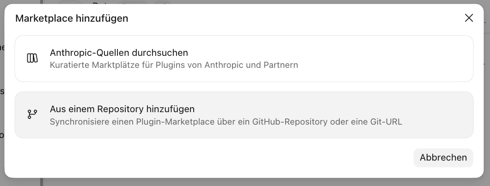
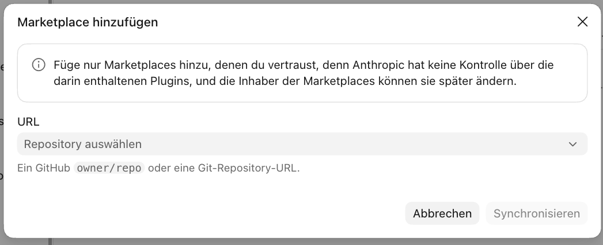

# Screens und Beispiele

**Deutsch** | [English](../en/screens.md)

[Start](../../README.md) · [Übersicht](README.md) · [Installation](installation.md) · [Nutzung](usage.md) · [Screens](screens.md) · [FAQ](faq.md)

## Vorschau

Diese Seite zeigt einen textlichen Ablauf. Es liegen noch keine echten Host-Screenshots vor; es werden keine simulierten Bilder als Produktaufnahmen ausgegeben.

## Beispielablauf

**Fiktives Beispiel, keine aufgezeichnete Modellantwort:** Ein Team stellt den Skill `beispiel-checkliste` bereit. Der Agent liest dessen Anweisungen, fragt nach einem unklaren Speichermodell und erstellt nach Klärung `README.md`, `README.en.md` sowie `docs/de/` und `docs/en/`. `verify` nennt fehlende Tests als offene Aufgabe.

## Echte Screenshots

Vom Nutzer bereitgestellte Originalaufnahmen: Claude Desktop, macOS, deutsche Oberfläche, 18.11.2026. Sie zeigen die Repository-Auswahl, keine erfolgreiche Installation. Die App-Version ist im Bild nicht sichtbar; separat wurden am selben Tag lokale App-Metadaten mit Version 5.11492.5 gelesen. Eine direkte Zuordnung dieser Version zu den Aufnahmen ist nicht bestätigt.

*Originalaufnahme vom Nutzer, 18.11.2026, 13:59:26 Uhr laut Dateiname: „Aus einem Repository hinzufügen“. Unverändert übernommen.*

*Originalaufnahme vom Nutzer, 18.11.2026, 13:59:42 Uhr laut Dateiname: leeres Repository-Feld, noch keine Synchronisierung. Unverändert übernommen.*

Weitere gelieferte Bilder belegen **Einstellungen → Anpassungen → Plugins → + Hinzufügen → Marketplace hinzufügen**. Sie werden wegen sichtbarer Kontodaten beziehungsweise persönlicher Plugin-Bestände nicht übernommen. Die obigen Dialogbilder enthalten keine sichtbaren Kontokennungen. Keine Codex- oder ChatGPT-Installationsscreenshots vorhanden.

## Aufnahmecheckliste

Nur fiktive oder freigegebene Inhalte aufnehmen. Keine Zugangsdaten, persönlichen Pfade oder privaten Tabs zeigen. Beschriftete Illustrationen getrennt unter `docs/assets/de/` und `docs/assets/en/` ablegen; Inhalt und Aussage müssen übereinstimmen.

---

Dokumentation erstellt mit ZYRIS Skill Manager. Die Urheberschaft des beschriebenen Produkts bleibt unverändert.

### Offene Installationsaufnahmen (18.11.2026)

Für Claude Desktop ist der Menüpfad bis zum Repository-Dialog durch Nutzeraufnahmen belegt. Offen bleiben eingegebene freigegebene Katalogadresse, erfolgreiche Synchronisierung, Produktauswahl, Installation, erster Start und Update. Für Codex und ChatGPT fehlen weiterhin die Installationsaufnahmen. Neue Aufnahmen nur mit fiktiven Daten in einem isolierten Profil; unter `docs/assets/de/` mit Oberfläche, OS, Version, Datum, Herkunft, Alt-Text und Bildunterschrift ablegen.
