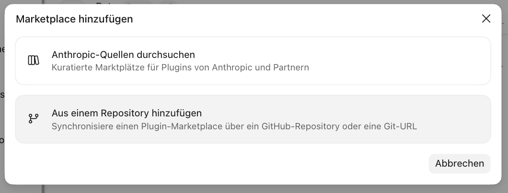
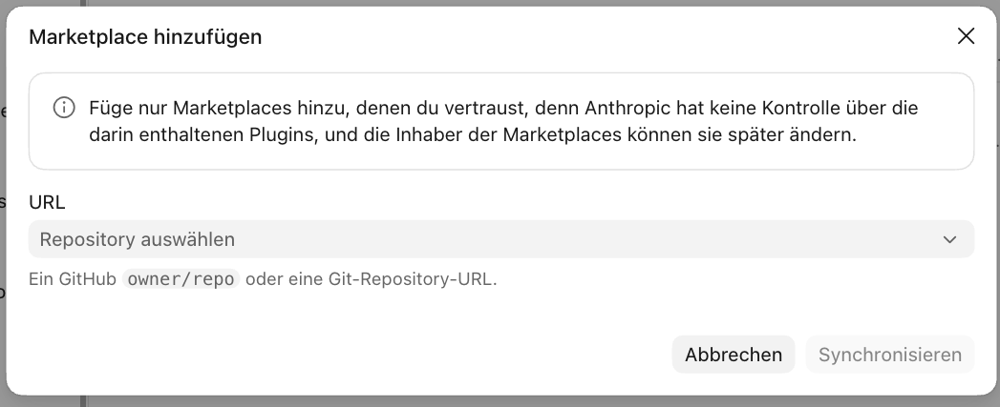

# Screens and examples

[Deutsch](../de/screens.md) | **English**

[Home](../../README.en.md) · [Overview](README.md) · [Install](installation.md) · [Use](usage.md) · [Screens](screens.md) · [FAQ](faq.md)

## Preview

This page provides a text walkthrough. Actual host screenshots are not yet available; no simulated images are presented as product captures.

## Example walkthrough

**Fictional example, not a recorded model response:** A team supplies the `example-checklist` skill. The agent reads its instructions, asks about an unclear storage model, then creates `README.md`, `README.en.md`, `docs/de/` and `docs/en/` after clarification. `verify` reports missing tests as pending work.

## Native screenshots

Original user-supplied captures: Claude Desktop, macOS, German UI, 2026-11-18. They show repository selection, not a successful installation. The app version is not visible in the images; local app metadata separately read that day reported 5.11492.5. That version is not confirmed for these captures.

*Original user capture, 2026-11-18 at 13:59:26 according to its filename. German UI, unchanged; “Aus einem Repository hinzufügen” means “Add from a repository”.*

*Original user capture, 2026-11-18 at 13:59:42 according to its filename. German UI, unchanged; the empty repository field does not demonstrate synchronization. This is not a translated screenshot.*

Other supplied images establish **Einstellungen → Anpassungen → Plugins → + Hinzufügen → Marketplace hinzufügen**. They are not included because they show account details or a personal plugin inventory. The two dialog captures above have no visible account identifiers. No Codex or ChatGPT installation screenshots are available.

## Capture checklist

Capture only fictional or authorized content. Hide credentials, personal paths and private tabs. Store labelled illustrations separately under `docs/assets/de/` and `docs/assets/en/`; their content and meaning must agree.

---

Documentation prepared with ZYRIS Skill Manager. Source-product ownership remains unchanged.

### Pending installation captures (2026-11-18)

For Claude Desktop, user captures establish the path through the repository dialog. Pending: approved catalog address entered, successful synchronization, product selection, installation, first use and update. Codex and ChatGPT installation captures remain pending. Use fictional data in isolated profiles for new captures; store under `docs/assets/en/` with surface, OS, version, date, provenance, alt text and caption. Preserve the language of original captures.
